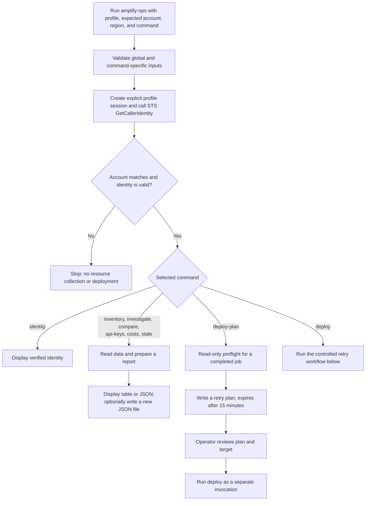
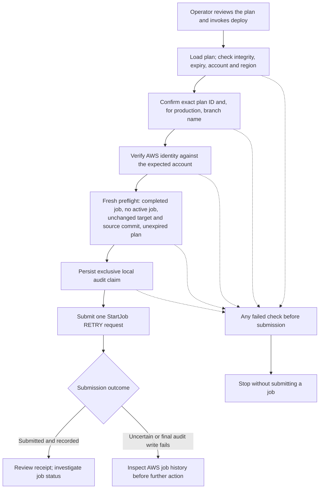

# CLI workflow

These diagrams describe the AWS operations in `bototoolkit` and its compatible
`amplify-ops` command. Both entry points run the same workflow.
AWS operations require an explicit profile, expected account, and region. Local
diagnostics and command help are outside the workflow shown here.
Select your local AWS profile and obtain the account and region from private
settings or the operator.

## Command overview

`investigate` reads bounded logs only when `--inspect-logs` is specified. `stale`
also gathers GitHub evidence; missing evidence can make a report partial. For
`deploy`, plan loading and confirmation checks happen before identity verification.
The CLI requires an explicit profile but does not restrict its name.
Verification details and diagnostics go
to stderr; JSON report output goes to stdout. The `identity` command also prints
identity details to stdout. The optional output file must be new. A partial report
exits with code 3; invalid arguments exit with code 2, while authentication,
blocked deployment, and output-file failures exit with code 1.

## Controlled retry deployment

The plan is a read-only proposal; reviewing it is an operator responsibility.
`deploy` is the sole AWS write path, requires separate `StartJob` permission, and
supports only retrying a completed job. It does not automatically retry or roll
back. Once the audit claim is made, an uncertain submission consumes that local
plan. The local claim protects against reuse in that audit directory; it is not
distributed idempotency. See [deployment details](remaining-commands.md) and the
[README](../README.md) for operating instructions.
